  

  
  
  

I build AI products on my own, with a handful of AI agents as my team. I ship fast, break things in public, and write down what worked and what did not.

### What I'm shipping

  
  

### Right now

  

### You pick what I ship next

  

  
  
  

Click one, press Submit, and the bar above moves. You can change your vote any time.

<b>How I work</b> (click)

- One human, several AI agents. I plan and decide; the agents write, test and report back.
- I ship small and early, then fix what breaks in front of real users.
- Every product starts from something I needed myself.
- Wins and failures both go in the notes.

<b>Say hi or ask me something</b> (click)

Open an issue <a href="https://github.com/Rishflips/Rishflips/issues/new?title=hi%20Rish">here</a>, or find me on <a href="https://x.com/rishflips">X @rishflips</a>.

### Daily commits

<picture>
  <source media="(prefers-color-scheme: dark)" srcset="https://raw.githubusercontent.com/Rishflips/Rishflips/output/snake-dark.svg">
  
</picture>

Built with one human and several agents. Things break here, and I write that down too.

